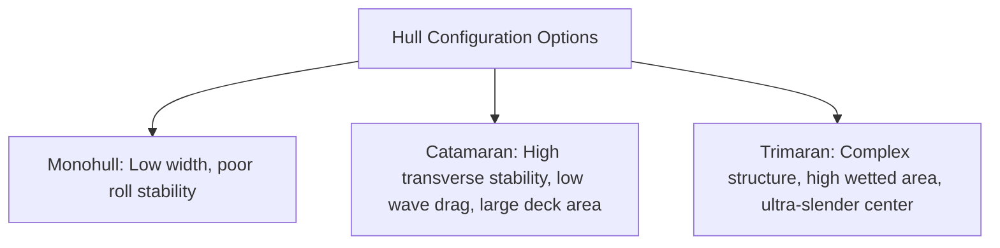
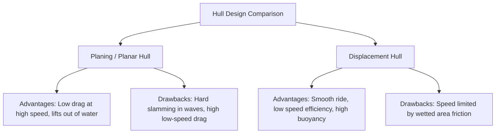

# Preliminary Design Report (PDR)
## Autonomous Surface Vehicle (ASV) Catamaran

---

## 1. Executive Summary

This report presents the preliminary design analysis for a high-performance Autonomous Surface Vehicle (ASV) intended for hydrographic surveying and environmental monitoring. The mission objective is to survey a lake with an area of $0.66\text{ km}^2$ using a lawnmower path, requiring a minimum operational range of $14\text{ km}$. 

To meet these requirements, we evaluate a catamaran hull configuration with a length of $0.95\text{ m}$, a hull centerline separation of $0.85\text{ m}$, and a hull beam of $0.1\text{ m}$. This configuration is analyzed hydrodynamically using Froude number scaling, wave interference theory, and section geometry calculations. We compare planing (planar) and displacement hulls, evaluate the Apisqueen U5 and U15 thrusters, analyze six battery-thruster configurations, and establish the structural and material design matrices for the vessel.

---

## 2. Hull Configuration Selection
Selecting the optimal hull configuration is critical for the vehicle's efficiency, payload capacity, and stability. We evaluate three options: **Monohull**, **Catamaran**, and **Trimaran**.



### 2.1 Theoretical Transverse Stability Comparison
The transverse stability of a vessel is governed by its metacentric height ($GM_T$), defined as:
$$GM_T = KB + BM_T - KG$$
Where:
* $KB$ is the vertical height of the center of buoyancy.
* $KG$ is the vertical height of the center of gravity.
* $BM_T$ is the transverse metacentric radius, given by:
  $$BM_T = \frac{I_T}{\nabla}$$
  Here, $I_T$ is the transverse moment of inertia of the waterplane area, and $\nabla$ is the displacement volume.

#### 2.1.1 Catamaran Mathematical Derivation
For a catamaran with two identical hulls of length $L$ and beam $B$, separated by a centerline distance $S$:
The total waterplane area is $A_{cat} = 2 \cdot L \cdot B$.
The transverse moment of inertia $I_{T, cat}$ about the vessel's centerline axis is computed via the parallel axis theorem:
$$I_{T, cat} = 2 \left( I_{hull} + A_{hull} \cdot \left(\frac{S}{2}\right)^2 \right)$$
Where the moment of inertia of an individual rectangular waterline section is:
$$I_{hull} = \frac{L B^3}{12}$$
Substituting the terms:
$$I_{T, cat} = 2 \left( \frac{L B^3}{12} + L B \frac{S^2}{4} \right) = \frac{L B^3}{6} + \frac{L B S^2}{2}$$

For our design parameters:
* $L = 0.95\text{ m}$
* $S = 0.85\text{ m}$
* $B = 0.1\text{ m}$

Calculating $I_{T, cat}$:
$$I_{T, cat} = \frac{0.95 \times (0.1)^3}{6} + \frac{0.95 \times 0.1 \times (0.85)^2}{2}$$
$$I_{T, cat} = 0.0001583 + 0.0343188 = 0.034477\text{ m}^4$$

#### 2.1.2 Equivalent Monohull Comparison
To provide a fair comparison, consider a monohull of the same length $L = 0.95\text{ m}$ and the same displacement volume $\nabla$. To match displacement, it has double the beam of a single catamaran hull: $B_{mono} = 2B = 0.2\text{ m}$.
The transverse moment of inertia of this monohull is:
$$I_{T, mono} = \frac{L B_{mono}^3}{12} = \frac{0.95 \times (0.2)^3}{12} = 0.000633\text{ m}^4$$

#### 2.1.3 Comparison Summary
Comparing the transverse waterplane inertias:
$$\frac{I_{T, cat}}{I_{T, mono}} = \frac{0.034477}{0.000633} \approx 54.46$$

The catamaran waterplane inertia is **54 times greater** than that of the equivalent monohull. This huge inertia results in an exceptionally large metacentric radius $BM_T$, ensuring superior stability and stiffness against roll, which is critical for maintaining stable sensor and camera orientations.

### 2.2 Performance Trade-Off Matrix

| Parameter / Metric | Monohull | Catamaran (Selected) | Trimaran |
| :--- | :--- | :--- | :--- |
| **Transverse Stability** | Poor ($I_T \propto B^3$) | Excellent ($I_T \propto B S^2$) | Outstanding |
| **Wetted Surface Area** | Minimal (lowest friction) | Moderate (+30-40% vs Monohull) | High (highest friction) |
| **Wave-Making Drag** | High (wide hull beam required) | Very Low (slender hulls $L/B = 9.5$) | Low |
| **Usable Deck Space** | Limited | Maximum (broad grid structure) | High but fragmented |
| **Structural Weight** | Lightest | Moderate | Heavy (complex crossbeams) |
| **Shallow Draft Capability**| Poor | Excellent | Moderate |

---

## 3. Hydrodynamic Dimension Rationale

The selected hull dimensions are:
* Hull length: $L = 0.95\text{ m}$
* Centerline separation: $S = 0.85\text{ m}$
* Individual hull beam: $B = 0.1\text{ m}$

This section provides the mathematical justification for these dimensions using Froude number analysis, Kelvin wave theory, and section geometry.

```
       |<--------------------- S = 0.85m --------------------->|
       |                                                       |
   +-------+                                               +-------+
   |       |                                               |       |
   | Hull 1|                                               | Hull 2|
   | B=0.1m|                                               | B=0.1m|
   +-------+                                               +-------+
   |<--L=0.95m---------------------------------------------------->|
```

### 3.1 Froude Number ($Fr$) and Dynamic Regimes
The Froude number ($Fr$) is a dimensionless parameter representing the ratio of inertial forces to gravitational forces in a fluid flow:
$$Fr = \frac{V}{\sqrt{g L}}$$
Where:
* $V$ is the vehicle speed ($\text{m/s}$).
* $g$ is the gravitational acceleration ($9.81\text{ m/s}^2$).
* $L$ is the characteristic waterline length ($0.95\text{ m}$).

The denominator represents the shallow water wave speed $\sqrt{g L} = \sqrt{9.81 \times 0.95} \approx 3.053\text{ m/s}$.

We evaluate $Fr$ for the speed configurations shown on the whiteboard:
1. **Target Survey Speed ($V = 3.5\text{ m/s}$)**:
   $$Fr = \frac{3.5}{3.053} \approx 1.15$$
2. **Cruising Speed with Buck Converter ($V = 4.0\text{ m/s}$)**:
   $$Fr = \frac{4.0}{3.053} \approx 1.31$$
3. **High-Speed Thrust Option ($V = 6.5\text{ m/s}$)**:
   $$Fr = \frac{6.5}{3.053} \approx 2.13$$

#### Hydrodynamic Significance:
* **$Fr < 0.4$**: Displacement regime. Buoyancy supports the vessel.
* **$0.4 \le Fr < 1.0$**: Semi-displacement (transitional) regime. Wave-making resistance increases rapidly, peaking at the "hump" speed around $Fr \approx 0.5$.
* **$Fr \ge 1.0$**: Planing regime. Hydrodynamic lift forces dominate, lifting the hull and reducing wetted surface area.

Our operating Froude numbers ($1.15 \le Fr \le 2.13$) put the ASV firmly in the **planing and high-speed semi-displacement regime**. This dictates that either a slender displacement hull or a flat-bottomed planing hull shape must be utilized to bypass the wave drag barrier.

---

### 3.2 Kelvin Wave Theory & Wave Interference

A moving ship generates a wave pattern consisting of two systems: **transverse waves** (crests perpendicular to travel direction) and **divergent waves** (crests angled outward). The boundaries of this wave pattern form the Kelvin wake angle:
$$\theta_K = \arcsin\left(\frac{1}{3}\right) \approx 19.47^\circ$$

```
                   \       /
                    \  *  /  <-- Kelvin Wake Angle (19.47 deg)
                     \ | /
    Hull 1 bow -----> ( ) ( ) <----- Hull 2 bow
                      | | |
                      | S | <-- S = 0.85m
                      | | |
                      |   |
```

In a catamaran, wave interference occurs when the wave system generated by Hull 1 interacts with Hull 2. This interaction is quantified by the spacing-to-length ratio ($S/L$):
$$\frac{S}{L} = \frac{0.85\text{ m}}{0.95\text{ m}} \approx 0.895$$

#### 3.2.1 Analysis of Bow Divergent Wave Interference
The bow divergent waves propagate outwards at an angle of $\theta = 19.47^\circ$. The longitudinal distance from the bow of Hull 1 where its divergent wave intersects the centerline of Hull 2 ($x_{\text{intersect}}$) is:
$$x_{\text{intersect}} = \frac{S}{\tan(\theta_K)} = \frac{0.85}{\tan(19.47^\circ)} = \frac{0.85}{0.3535} \approx 2.40\text{ m}$$

Since $x_{\text{intersect}} \approx 2.40\text{ m}$ is much greater than the hull length ($L = 0.95\text{ m}$):
* **The bow divergent waves from each hull do not strike the opposite hull along its length.**
* Instead, they pass completely behind the transom of the adjacent hull.
* This eliminates the local high-pressure wave reflection and hull-impingement drag that typically occurs in narrow catamarans ($S/L < 0.4$).

#### 3.2.2 Analysis of Transverse Wave Interference
The wavelength of the transverse wave system ($\lambda$) generated by a vessel moving at speed $V$ is:
$$\lambda = \frac{2 \pi V^2}{g}$$

* For $V = 3.5\text{ m/s}$:
  $$\lambda = \frac{2 \pi \times 3.5^2}{9.81} \approx 7.85\text{ m}$$
* For $V = 4.0\text{ m/s}$:
  $$\lambda = \frac{2 \pi \times 4.0^2}{9.81} \approx 10.25\text{ m}$$

Because $\lambda \gg S$ ($\lambda \approx 8-10\text{ m}$ compared to $S = 0.85\text{ m}$), the transverse waves from both hulls are essentially in-phase and do not create local steep, destructive wave crests between the hulls. Furthermore, because the hulls are highly slender:
$$\frac{L}{B} = \frac{0.95}{0.1} = 9.5$$
The wave-making amplitude scales with the square of the beam-to-length ratio:
$$C_w \propto \left(\frac{B}{L}\right)^2 \approx \left(\frac{1}{9.5}\right)^2 \approx 0.011$$
The individual wave energy generated by each hull is extremely small, ensuring minimal wave drag even under constructive interference conditions.

---

### 3.3 Planar and Displacement Section Calculations

To determine the buoyancy and draft profiles, we analyze the cross-sections of a **Displacement Hull** (circular bilge) and a **Planing Hull** (flat bottom with hard chines).

```
   DISPLACEMENT SECTION (Round Bilge)        PLANAR SECTION (Hard Chine V-Shape)
           |<---- B = 0.1m ---->|                    |<---- B = 0.1m ---->|
         --+--------------------+--                --+--------------------+--
           |                    |                    \                    /
           |       Draft d      |                     \    Draft d       /
           |                    |                      \                /  Deadrise
           \         .          /                       \              /   Angle beta
            \      r=0.05      /                         \  ._________/
             `---________---'                             \__________/
```

#### 3.3.1 Displacement Section Calculations (Round Bilge)
Assuming a parabolic or semi-circular bilge of radius $r = B/2 = 0.05\text{ m}$ with vertical sides up to draft $d$:
The cross-sectional area $A_c$ as a function of draft $d$ is:
$$A_c(d) = \begin{cases} 
      B \cdot d - B \cdot r \left(1 - \frac{\pi}{4}\right) & \text{if } d \ge r \\
      \frac{\pi d^2}{2} \text{ (approximate semi-ellipse)} & \text{if } d < r 
   \end{cases}$$

For $d \ge 0.05\text{ m}$:
$$A_c(d) = 0.1 \cdot d - 0.1 \cdot 0.05 \cdot (1 - 0.7854) = 0.1 \cdot d - 0.001073$$

The displacement volume $\nabla$ of one hull is computed using the prismatic coefficient ($C_p = 0.65$):
$$\nabla = L \cdot A_c(d) \cdot C_p = 0.95 \cdot (0.1 \cdot d - 0.001073) \cdot 0.65$$
$$\nabla = 0.6175 \cdot d - 0.000663$$

For a total system mass of $M = 6.7\text{ kg}$ (Option 4, U5 thruster set), the total displacement volume needed in fresh water ($\rho = 1000\text{ kg/m}^3$) is:
$$\nabla_{\text{total}} = \frac{M}{\rho} = \frac{6.7}{1000} = 0.0067\text{ m}^3$$
The displacement volume required per hull ($\nabla_{\text{hull}}$) is:
$$\nabla_{\text{hull}} = \frac{0.0067}{2} = 0.00335\text{ m}^3$$

Solving for required draft $d$:
$$0.00335 = 0.6175 \cdot d - 0.000663$$
$$0.6175 \cdot d = 0.004013 \implies d \approx 0.0065\text{ m} = 6.5\text{ cm}$$

This draft ($6.5\text{ cm}$) is slightly larger than the hull radius ($5.0\text{ cm}$), meaning the water level sits on the flat vertical sides of the displacement hull, providing a stable waterplane area.

#### 3.3.2 Planar Section Calculations (Planing Hull)
A planing hull relies on hydrodynamic lift $L_H$ to support weight at high speed. The lift is estimated using Savitsky's planing equation:
$$L_H = \frac{1}{2} \rho V^2 B^2 C_L$$
Where $C_L$ is the lift coefficient. For a flat plate with trim angle $\tau$ (degrees) and wetted length ratio $\lambda_p = L_w / B$:
$$C_{L0} = \tau^{1.1} \left( 0.012 \sqrt{\lambda_p} + \frac{0.0055 \lambda_p^{2.5}}{Fr_B^2} \right)$$
Where the beam Froude number is:
$$Fr_B = \frac{V}{\sqrt{g B}} = \frac{3.5}{\sqrt{9.81 \times 0.1}} \approx 3.53$$

At high speeds, as lift $L_H$ increases:
1. The hull climbs in the water, reducing the draft $d$ and wetted length $L_w$.
2. The wetted surface area $S_w = 2 \cdot L_w \cdot B_w$ drops.
3. Frictional resistance $R_f = \frac{1}{2} \rho V^2 C_f S_w$ is minimized.
4. Total drag drops significantly compared to a displacement hull, which remains submerged.

---

## 4. Hull Profile Comparison: Planar vs. Displacement

We compare the two primary hull designs under consideration for our specific speed range:



### 4.1 Planar (Planing) Hull
* **Description**: Features a flat bottom or shallow V-shape with sharp, distinct edges (hard chines) that force water to spray outward rather than wrapping around the hull.
* **Hydrodynamic Mechanism**: Relies on dynamic lift pressure at Froude numbers $Fr > 1.0$.

### 4.2 Displacement Hull
* **Description**: Features rounded bilges and smooth profiles designed to slice through the water rather than riding on top of it.
* **Hydrodynamic Mechanism**: Relies entirely on hydrostatic buoyancy ($F_B = \rho g \nabla$).

### 4.3 Detailed Comparison Table

| Feature / Criteria | Planar (Planing) Hull | Displacement Hull |
| :--- | :--- | :--- |
| **Buoyancy Type** | Dynamic lift at high speed; Hydrostatic at low speed | Hydrostatic buoyancy at all speeds |
| **Drag vs. Speed Curve** | High initial drag, but flattens out at high speeds | Low drag at low speed, increases exponentially at high speed |
| **Optimal Froude Range** | $Fr \ge 1.0$ (Ideal for our $3.5 - 6.5\text{ m/s}$ range) | $Fr < 0.4$ (Inefficient for our speeds) |
| **Wetted Surface Area** | Decreases as speed increases | Remains constant or increases slightly |
| **Seakeeping & Stability**| Can slam in rough water, but very stable in flat water | Smoother ride in waves, lower roll stiffness |
| **Transom Design** | Flat, sharp cut-off to promote flow separation | Curved, tapered stern to minimize eddies |
| **Power Requirement** | Lower power required to maintain high speeds | High power required to push past wave barrier |

---

## 5. Thruster Analysis: Apisqueen U5 vs. U15

We evaluate the performance and efficiency of two underwater thrusters from Apisqueen: **U5** and **U15**.

```
   Apisqueen U5 (Compact, High RPM)          Apisqueen U15 (Large, High Efficiency)
          __                                          ____
      ===|  |== (Prop: ~55mm)                     ===|    |== (Prop: ~95mm)
          --                                          ----
       Weight: 0.25 kg                             Weight: 1.50 kg
       Thrust: 5.7 kgf                             Thrust: up to 15 kgf
```

### 5.1 Propeller Disk Theory & Efficiency
From the momentum theory of propellers (actuator disk theory), the thrust $T$ generated is:
$$T = 2 \rho A v_p (v_p - v_0)$$
Where:
* $A$ is the propeller disk area: $A = \frac{\pi}{4} D^2$ ($D$ is propeller diameter).
* $v_0$ is the advance speed (vehicle speed).
* $v_p$ is the velocity of the water at the propeller disk.

The induced power $P_i$ required to generate this thrust is:
$$P_i = T \cdot v_p = T \left( v_0 + \frac{v_j - v_0}{2} \right)$$
Where $v_j$ is the slipstream jet velocity. The propulsive efficiency $\eta_p$ is defined as:
$$\eta_p = \frac{T \cdot v_0}{P_i} = \frac{2}{1 + v_j/v_0}$$

#### Physical Principle of the U15 Superiority:
For a given target thrust $T$:
1. The **U15** has a much larger propeller diameter ($D \approx 95\text{ mm}$) compared to the **U5** ($D \approx 55\text{ mm}$).
2. The propeller disk area of the U15 is approximately **3 times larger** than that of the U5.
3. To produce the same thrust, the U15 can accelerate a larger mass of water to a lower jet velocity ($v_j$), whereas the U5 must accelerate a smaller mass of water to a much higher velocity.
4. Since kinetic energy lost in the wake scales with $v_j^2$, the U15 operates with a much higher propulsive efficiency $\eta_p$.
5. This higher efficiency translates directly to a **21.4% increase in battery runtime (1.214X factor)**, even though the U15 adds an extra $2.5\text{ kg}$ of weight to the vehicle.

---

## 6. Battery & Mission Range Trade-Offs

The target lake survey has an area of $0.66\text{ km}^2$. 
Using a lawnmower sweep path with a conservative sonar swath width of $50\text{ m}$:
$$D_{\text{path}} = \frac{A_{\text{lake}}}{w_s} = \frac{660,000\text{ m}^2}{50\text{ m}} = 13,200\text{ m} = 13.2\text{ km}$$
Allowing for $0.8\text{ km}$ of transit and turn overhead, the required mission range is **$14.0\text{ km}$**.

### 6.1 Battery Options Comparison Matrix
Below is the compilation of the 6 battery and thruster configurations transcribed from the design whiteboard:

| Option | Battery Type | Battery Weight | Capacity | Total Thrust | Thrusters | Speed | Runtime | Total Weight (with U5)* | Range | Cost |
| :---: | :--- | :---: | :---: | :---: | :---: | :---: | :---: | :---: | :---: | :---: |
| **1** | 1x Li-Po (6S) | $2.5\text{ kg}$ | $22\text{ Ah}$ | $5.7\text{ kgf}$ | U5 | $3.5\text{ m/s}$ | $39\text{ min}$ | $5.6\text{ kg}$ | $8.15\text{ km}$ | Rs 17.4k |
| **2** | 2x Li-Po (6S) | $5.2\text{ kg}$ | $44\text{ Ah}$ | $5.7\text{ kgf}$ | U5 | $3.5\text{ m/s}$ | $78\text{ min}$ | $8.2\text{ kg}$ | $16.30\text{ km}$ | Rs 34.8k |
| **3** | 2x Li-Po (6S) | $4.8\text{ kg}$ | $32\text{ Ah}$ | $5.7\text{ kgf}$ | U5 | $3.5\text{ m/s}$ | $56\text{ min}$ | $7.8\text{ kg}$ | $11.76\text{ km}$ | Rs 15.0k |
| **4** | **2x Li-ion (6S)**| **$3.7\text{ kg}$** | **$40\text{ Ah}$**| **$5.7\text{ kgf}$**| **U5** | **$3.5\text{ m/s}$**| **$67\text{ min}$**| **$6.7\text{ kg}$** | **$14.00\text{ km}$**| **Rs 22.0k**|
| **5** | 1x Li-Po (10S)| $3.6\text{ kg}$ | $20\text{ Ah}$ | $9.0\text{ kgf}$ | U15 (2) | $6.5\text{ m/s}$ | $30\text{ min}$ | $6.6\text{ kg}$ | $11.70\text{ km}$ | Rs 17.5k |
| **6** | 1x Li-Po (10S)| $3.6\text{ kg}$ | $20\text{ Ah}$ | $6.3\text{ kgf}$ | U15 (Buck) | $4.0\text{ m/s}$ | $51\text{ min}$ | $6.6\text{ kg}$ | $12.24\text{ km}$ | Rs 17.5k |

*\*Note: Total weight with U5 thrusters includes a constant structural/payload base weight of $2.6\text{ kg}$ (hulls, frame, electronics box, sonar). For U15 configurations, add $2.5\text{ kg}$ of additional thruster weight.*

### 6.2 Range vs. Cost Performance (U5 vs. U15)

If we upgrade the thruster system from U5 to U15, the operational range increases by **1.214X (21.4%)** across all options.

```
       Range Comparison (km) for Selected Options
       -------------------------------------------
       Option 1 (U5)   : ====== 8.15 km
       Option 1 (U15)  : ======== 9.89 km
       
       Option 4 (U5)   : ============ 14.00 km  (Target Met)
       Option 4 (U15)  : =============== 17.00 km (High Safety Margin)
```

* **Option 4 (U5)** meets the target range of $14\text{ km}$ exactly with a total weight of $6.7\text{ kg}$ and a total cost of **Rs 60.0k** (calculated as Rs 22k battery + Rs 16k thrusters + Rs 22k base).
* Upgrading **Option 4 to U15** increases the range to **$17\text{ km}$**, but increases the total weight to $9.2\text{ kg}$ (due to U15 weight) and the cost to **Rs 71.0k** (Rs 22k battery + Rs 27k thrusters + Rs 22k base).
* **Option 2 (U5)** provides $16.3\text{ km}$ of range but carries a significant weight penalty ($8.2\text{ kg}$ total) and high cost (**Rs 68.8k**).

---

## 7. Structural Frame & Electronics Stack Architecture

The frame is designed as a rigid, lightweight grid structure to bridge the two catamaran hulls while keeping the center of mass (CoM) as low as possible.

```
                  +-----------------------------------+
                  |        Locking Upper Plate        |
    ==============+===================================+============== <-- Carbon Rods
    Hull 1        |                                   |        Hull 2
    +-------+     |   Electronics & Battery Box       |     +-------+
    |       |     |   (Suspended below the frame)     |     |       |
    |       |     |                                   |     |       |
    +-------+     +-----------------------------------+     +-------+
                  | <--- Low Center of Mass (CoM) --->|
```

### 7.1 Low CoM Grid Design
1. **Grid Layout**: The frame is composed of cylindrical carbon fiber tubes assembled in a rectangular grid. This provides high torsional stiffness to resist the forces twisting the hulls in waves.
2. **Suspended Electronics Box**: Rather than mounting the heavy electronics and battery box on top of the frame, the box is suspended *within* the grid structure.
3. **Locking Mechanism**: The box drops down through the center grid opening. The top flange of the box rests on the carbon frame and is secured by a locking latch plate. The bulk of the box (containing the heavy batteries) hangs *below* the frame level.
4. **Hydrostatic Benefit**: By lowering the batteries, the vertical center of gravity ($KG$) is minimized. This maximizes the metacentric height ($GM_T = KB + BM_T - KG$), ensuring the vehicle has a strong self-righting tendency and remains stable during operations.

---

## 8. Material Selection Study

Since the final materials have not yet been decided, we evaluate the proposed materials for the hull and frame.

### 8.1 Hull Material Evaluation Matrix

| Material Option | Density (kg/m³) | Relative Cost | Durability / Impact Resistance | Fabrication Ease | Water Absorption Risk | Recommendation |
| :--- | :---: | :---: | :--- | :--- | :--- | :--- |
| **Fiberglass (GFRP)** | ~1800 | Medium | High | Hard (requires molds) | Very Low | **High** (Professional finish) |
| **Marine Plywood + Fiberglass**| ~700 | Low | High | Medium (woodworking) | Low (if fully sealed) | **High** (Best for rapid prototyping) |
| **3D Printed (PETG/ASA)** | ~1200 | Medium | Moderate (layer adhesion risk)| Easy (automated) | Low | **Medium** (Good for complex sections) |
| **Aluminum** | 2700 | High | Outstanding | Very Hard (welding) | None | **Low** (Too heavy/difficult for size) |
| **Plastic/Rotomolded** | ~950 | Low | High | Very Hard (molds) | None | **Low** (Hard to customize) |
| **Commercial Floats (PVC)** | ~100 | Very Low | Low | Very Easy | None | **Low** (Hydrodynamically inefficient) |

### 8.2 Frame Material Evaluation Matrix

| Material Option | Stiffness-to-Weight | Corrosion Resistance | Fabrication / Joining | Relative Cost | Recommendation |
| :--- | :---: | :--- | :--- | :---: | :--- |
| **Carbon Fiber Rods** | **Outstanding** | **Excellent** | Easy (carbon sleeve glue/brackets) | High | **Recommended** |
| **Aluminum Rods** | High | Good (needs anodizing) | Hard (welding/threading) | Medium | **Alternative** |
| **Plastic Rods** | Low | Excellent | Easy (glue/heat) | Low | **Not Recommended** (Too flexible) |
| **3D Printed Rods** | Low-Medium | Excellent | Easy | Low | **Not Recommended** (Prone to bending) |

---

## 9. Design Render

The proposed design integration, showing the twin hulls, carbon grid frame, and low-CoM electronics box layout, is visualized in the 3D render below:


